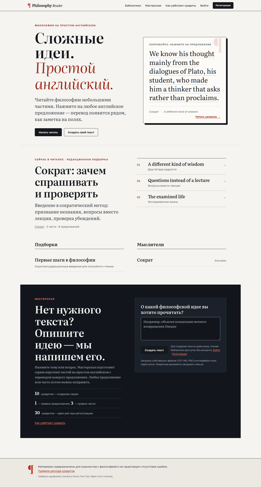
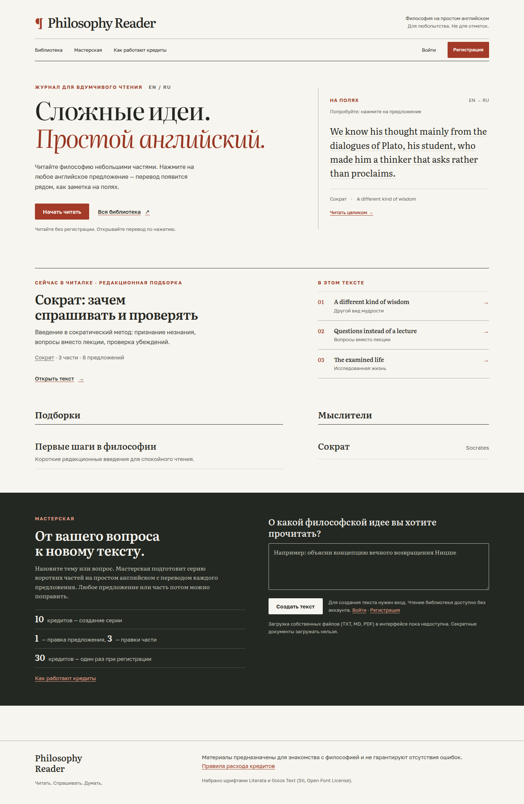
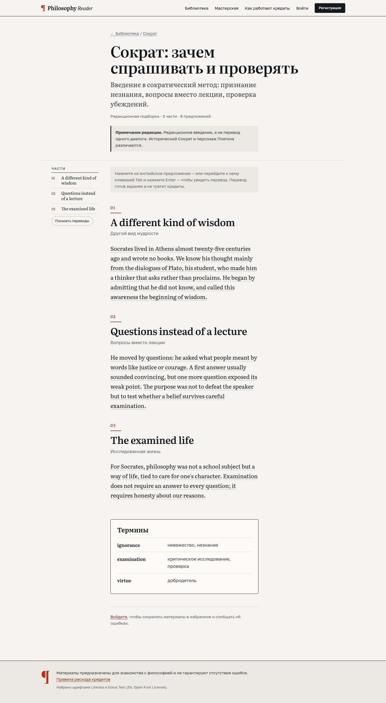
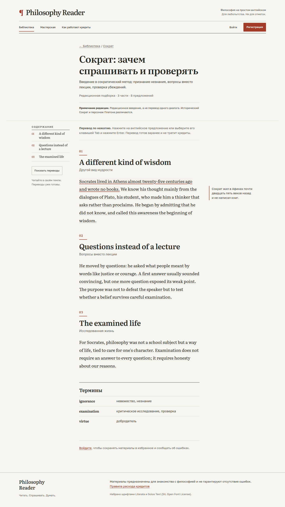

# Redesign v1 evidence

Real Django pages rendered in Chromium on 2026-11-13. The separate local
PostgreSQL database contains only seeded/disposable data; AI was fake-only.

## Before and after

Home, original at 1440 px:

Home, redesigned at 1440 px:

Reader, original at 1440 px:

Reader, redesigned with one margin translation at 1440 px:

## Additional views and logs

- `home-after-390.png`, `reader-after-390.png`: narrow-screen full pages.
- `catalog-after-1440.png`: real seeded catalogue.
- `workshop-after-390.png`: actual FakeProvider project, open edit/translation state.
- `browser-results.json`: 59 recorded passing interaction checks, 45 page/width
  results, 24 DOM stress cases, 15 text-scale cases, 16 clean axe scans.
- `final-tests.log`: final Django test result, 132/132.
- `final-check.log`, `final-migrations.log`, `final-static.log`: system check,
  unchanged migration state and successful hashed static collection.

The user delivery also contains all 12 before and 49 after screenshots.
The 49 include the 45-page matrix and four additional states; they do not mean
49 different routes. See `../REDESIGN_V1.md` for commands, scope and limits.
