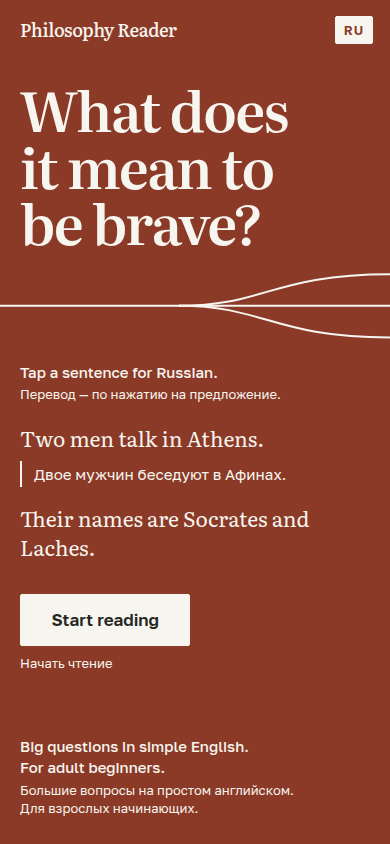
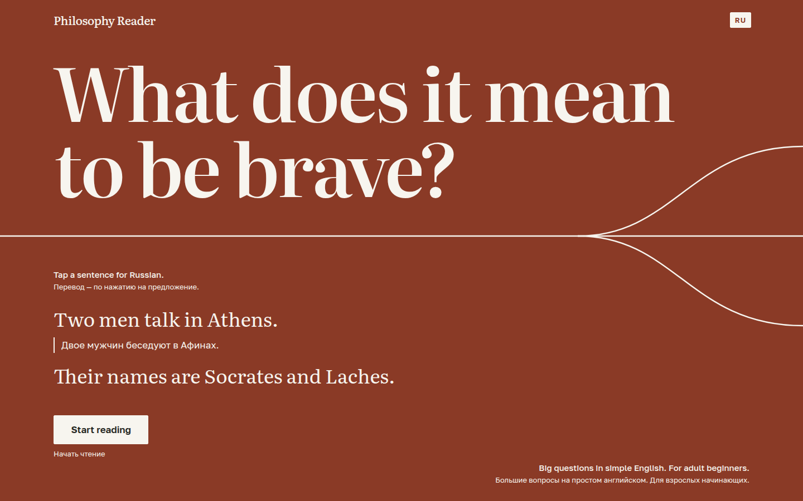
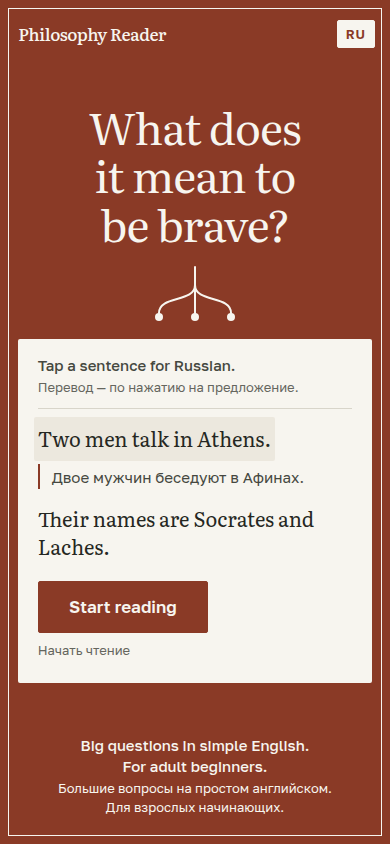
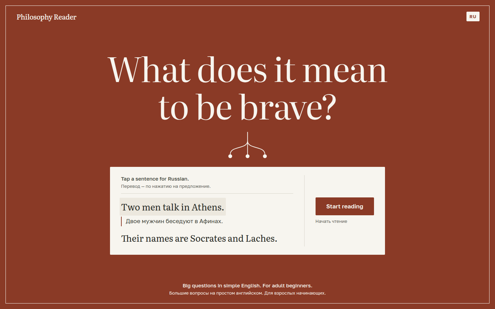
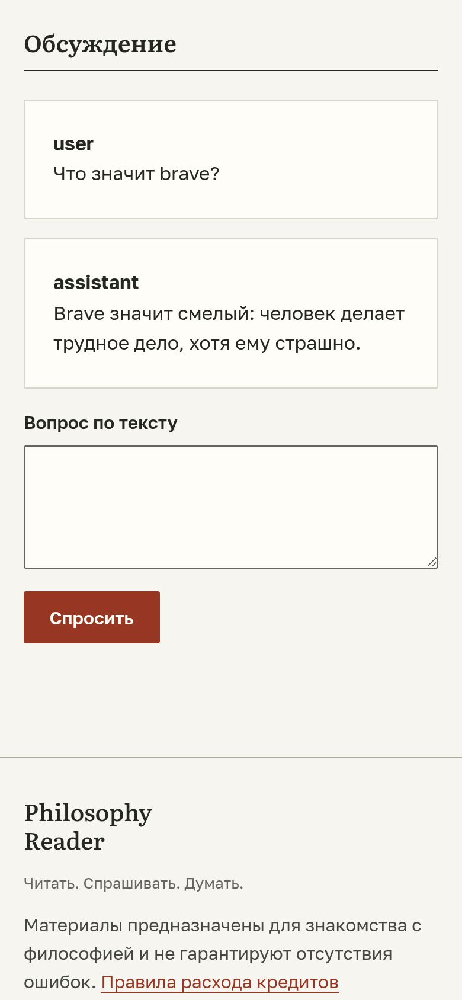
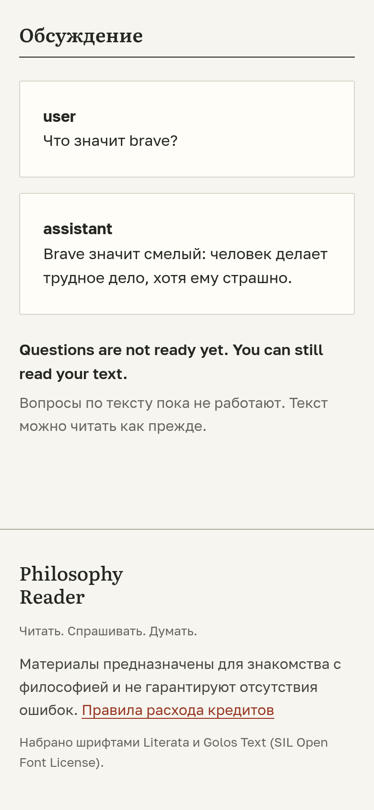
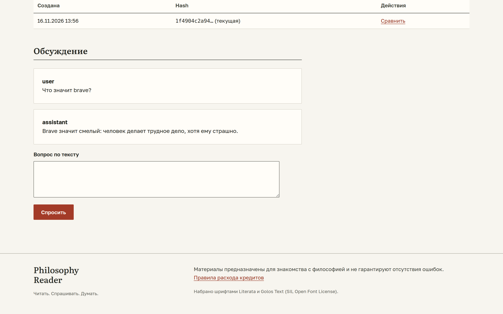
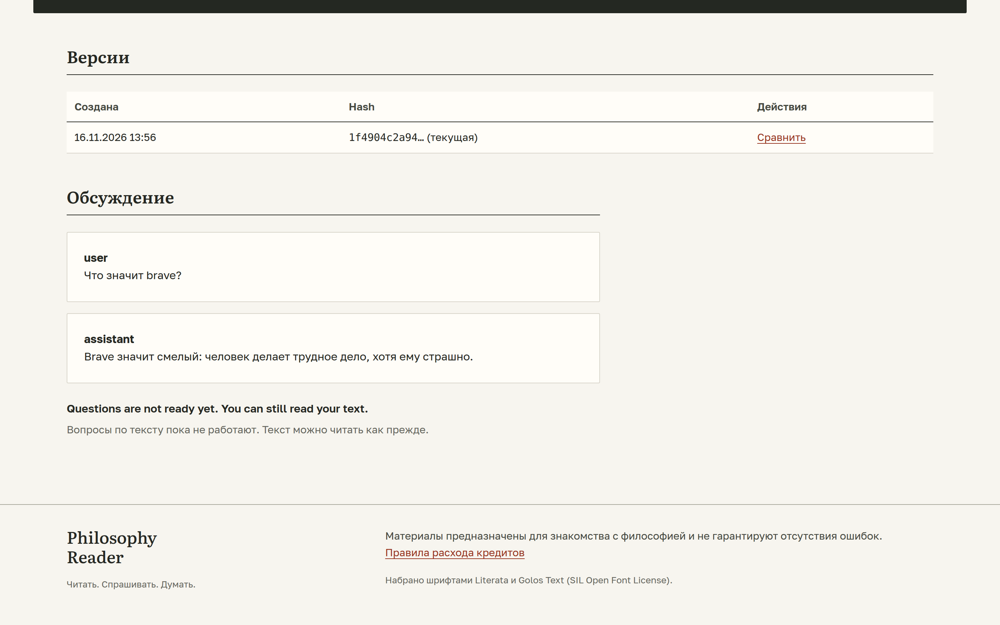

# Снимки этапов C и D

Снято в Chromium, 16 ноября 2026 года. Ширина окна 390 и 1440 px.

## Этап D. Два варианта первого экрана

Статичные макеты, в приложение не встроены. Владелец выбирает один.

### Вариант A «Поле»

Сплошной цвет, крупный вопрос слева, развилка — линия через весь экран.

| 390 px | 1440 px |
|---|---|
|  |  |

### Вариант B «Переплёт»

Тонкая рамка, вопрос по центру, предложения на светлой вставке.

| 390 px | 1440 px |
|---|---|
|  |  |

## Этап C. Мастерская: вопрос по тексту выключен

Слева — до изменений (ветка `main`), справа — после.

### 390 px

| До | После |
|---|---|
|  |  |

### 1440 px

| До | После |
|---|---|
|  |  |
